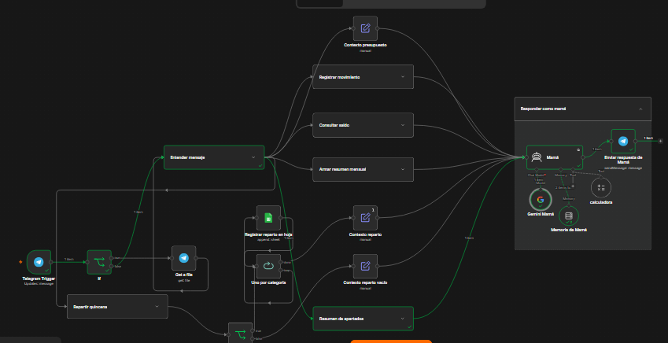
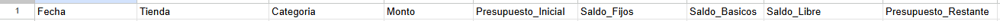
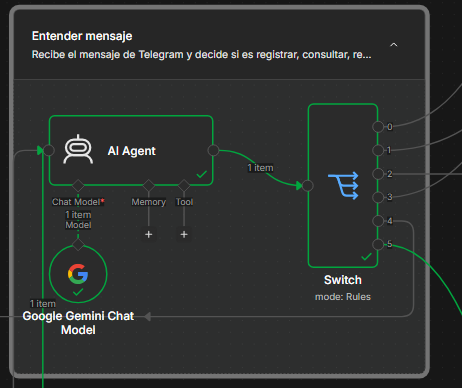
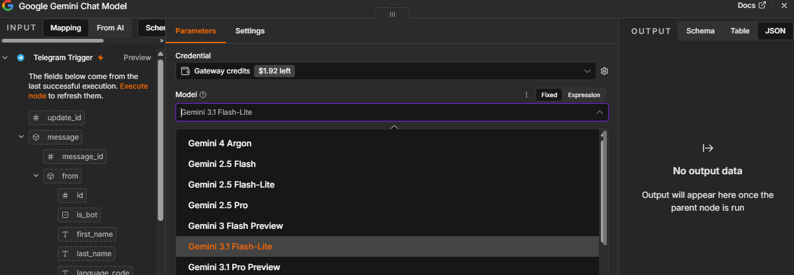
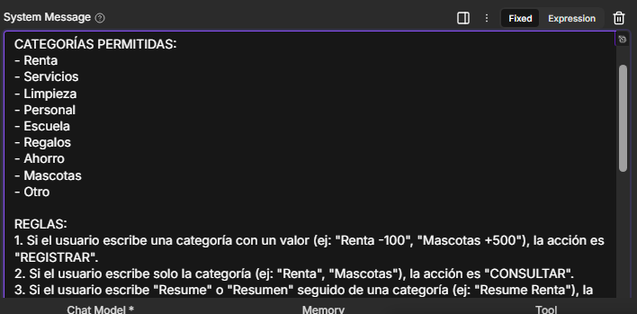
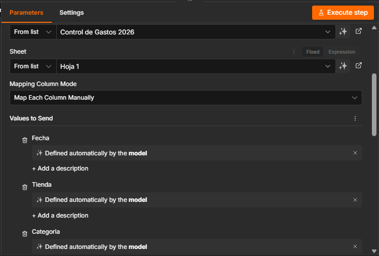
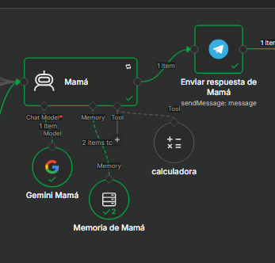
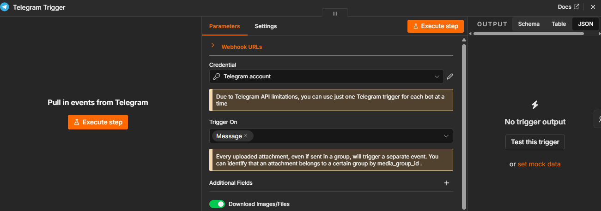
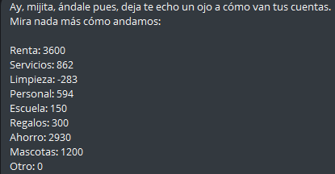

# Asistente Financiero Personal con n8n

Este proyecto implementa un flujo de trabajo automatizado en **n8n** que funciona como un asistente financiero personal interactivo a través de **Telegram**. El sistema utiliza una arquitectura multi-agente impulsada por **Google Gemini** (`models/gemini-3.5-flash-lite`) para clasificar intenciones, procesar tanto mensajes de texto como fotografías de tickets de compra, gestionar presupuestos quincenales y registrar cada movimiento en una hoja de cálculo de **Google Sheets** dividida por apartados.

Principalmente, se configuró la integración con la API de Telegram, cuya función es la recepción y envío de mensajes hacia y desde el sistema automatizado. Dentro de esta plataforma opera el chatbot, el cual captura las entradas del usuario para que sean procesadas por n8n y devueltas mediante un segundo agente conversacional con la personalidad de una madre mexicana que supervisa la salud financiera del usuario.

## Objetivo

La prioridad de nuestro proyecto es ayudar a los usuarios a llevar un registro detallado y disciplinado de sus ingresos y egresos, automatizando el proceso contable a través de mensajería instantánea para brindar una experiencia ágil, cercana y eficiente. A diferencia de una hoja de cálculo tradicional, el sistema busca acompañar al usuario mediante retroalimentación inmediata, planeación de presupuestos quincenales y alertas cuando un gasto compromete el saldo disponible en sus apartados.

## Cómo se Implementó el Desarrollo

Para llevar a cabo este proyecto, se realizó una investigación previa sobre las herramientas de orquestación de flujos de trabajo y la integración de modelos de lenguaje de gran tamaño (LLM) con bases de datos en la nube. El desarrollo se dividió en cuatro etapas principales:

1. **Integración del Canal de Comunicación:** Se creó el bot en Telegram mediante BotFather y se vinculó con n8n para escuchar eventos de texto y archivos multimedia en tiempo real.
2. **Clasificación Semántica y Visión por Computadora:** Se diseñó un primer agente de inteligencia artificial enfocado exclusivamente en entender qué desea hacer el usuario (registrar, consultar, resumir, armar un presupuesto o repartir su quincena) y extraer datos estructurados en formato JSON, incluyendo la lectura automática de tickets físicos mediante fotografía.
3. **Persistencia de Datos por Categorías:** Se estructuró un libro de Google Sheets donde cada categoría financiera cuenta con su propia pestaña independiente, permitiendo registrar entradas, salidas y consultar saldos actualizados al instante.
4. **Agente Conversacional con Memoria y Herramientas:** Se implementó un segundo agente denominado `Mamá`, dotado de memoria conversacional y una herramienta de calculadora matemática, encargado de armar planes financieros quincenales sin errores de cálculo y redactar las respuestas finales para el usuario.

## Diseño General del Workflow

El flujo de trabajo sustituye las estructuras lineales simples por una arquitectura modular dividida en siete bloques lógicos. Todo inicia en la recepción del mensaje de Telegram, pasa por el clasificador de intenciones (`AI Agent`), se distribuye a través de un enrutador central (`Switch`) hacia la operación correspondiente en Google Sheets y converge finalmente en el agente conversacional (`Mamá`) que envía la respuesta al usuario.

Para comprender mejor cómo interactúan estos módulos y cómo fluye la información desde que el usuario envía un mensaje hasta que recibe una respuesta, a continuación se muestra el panorama completo del flujo de trabajo en el lienzo de n8n:

## Requisitos Previos

1. **Instancia de n8n:** Versión compatible con nodos de LangChain (`@n8n/n8n-nodes-langchain.agent` v3.1) y ejecución de código en JavaScript.
2. **Bot de Telegram:** Creado mediante BotFather con su respectivo Token de API configurado en las credenciales de n8n.
3. **Google Gemini API:** Acceso configurado al modelo `models/gemini-3.5-flash-lite`.
4. **Google Sheets (OAuth2):** Credencial activa en n8n con permisos de lectura y escritura sobre Google Drive y Google Sheets.

---

## Configuración y Funcionamiento de los Módulos en n8n

### 1. Recepción de Mensajes y Captura de Imágenes (`Telegram Trigger`, `If` y `Get a file`)
El flujo inicia con el nodo `Telegram Trigger`, el cual escucha en tiempo real cualquier mensaje entrante con la opción de descarga activa (`download: true`). Inmediatamente después, un nodo condicional (`If`) evalúa si el mensaje contiene una fotografía (`$json.message.photo`):
- Si el usuario envió la foto de un ticket de compra, el flujo se dirige al nodo `Get a file` para descargar el archivo binario de los servidores de Telegram y entregarlo al agente clasificador.
- Si el usuario envió únicamente texto, pasa de forma directa al agente clasificador.

En la siguiente captura se observa cómo está configurada esta primera etapa de entrada y validación de archivos multimedia:

---

### 2. Clasificación de Intenciones y Lectura de Tickets (`AI Agent` y `Switch`)
El primer agente (`AI Agent`), conectado al modelo `Google Gemini Chat Model`, analiza el texto o la imagen binaria recibida (`passthroughBinaryImages: true`) y clasifica el movimiento dentro de una de las 9 categorías permitidas: `Renta`, `Servicios`, `Limpieza`, `Personal`, `Escuela`, `Regalos`, `Ahorro`, `Mascotas` u `Otro`.

El agente devuelve estrictamente un objeto JSON con la propiedad `accion`, `categoria` y `monto`. Posteriormente, el nodo enrutador `Switch` lee la propiedad `accion` y desvía el flujo hacia una de las seis rutas disponibles:
1. `REGISTRAR`: Cuando el usuario anota un ingreso o gasto (ej. `"Renta -100"`, `"Mascotas +500"`) o envía la fotografía de un ticket de compra.
2. `CONSULTAR`: Cuando escribe únicamente el nombre de una categoría para saber su saldo actual.
3. `RESUMIR`: Cuando solicita el balance mensual de un apartado (ej. `"Resumen Renta"`).
4. `PRESUPUESTO`: Cuando platica con el asistente sobre cuánto gana y cuáles son sus gastos para armar o ajustar un plan quincenal.
5. `REPARTIR`: Cuando aprueba el plan propuesto y solicita que el dinero de su quincena se guarde automáticamente en cada apartado de Google Sheets
6. `RESUMEN_GENERAL`: Cuando solicita ver el estado actual de todas sus categorías al mismo tiempo.

A continuación se ilustra la configuración del agente clasificador junto con el nodo `Switch` que distribuye las seis rutas de operación:

---

### 3. Operaciones Directas por Categoría: Registrar, Consultar y Resumir
Cuando el enrutador detecta una operación sobre un apartado específico, ejecuta una de las siguientes tres ramas conectadas a Google Sheets:

- **Rama Registrar Movimiento (`Append row in sheet` -> `Get balance after` -> `Contexto registro`):** Inserta una nueva fila en la pestaña correspondiente a la categoría con la fecha actual (`yyyy-MM-dd`) y el monto (positivo para ingresos, negativo para gastos). Acto seguido, lee el rango `A1:D2` de esa misma pestaña para obtener el saldo actualizado (`Total`) y empaqueta la información indicando cuánto dinero había antes y cuánto queda después del movimiento.
- **Rama Consultar Saldo (`Get row(s) in sheet` -> `Contexto consulta`):** Accede directamente al rango `A1:D2` de la hoja solicitada para extraer el valor de la columna `Total` sin modificar ningún registro.
- **Rama Resumen Mensual (`Get rows for summary` -> `Build monthly summary`):** Extrae todas las filas de la pestaña indicada y utiliza un nodo de código JavaScript (`Build monthly summary`) que filtra únicamente los movimientos del mes y año en curso, sumando por separado los ingresos, los gastos y calculando el balance neto del mes.

En la siguiente imagen se aprecia la disposición de estas tres ramas de lectura y escritura sobre la hoja de cálculo:

### 4. Planeación Quincenal y Reparto Automático (`Extraer reparto` y `Uno por categoría`)
Una de las funciones más avanzadas del sistema es ayudar al usuario a planear su quincena y distribuirla automáticamente en el documento de Google Sheets:

- **Planeación (`Contexto presupuesto`):** Si el usuario envía datos sobre su sueldo y gastos fijos, el flujo dirige el mensaje directamente al agente `Mamá` ignorando temporalmente el archivo de Excel para trabajar en una propuesta en memoria.
- **Ejecución del Reparto (`Extraer reparto` -> `Parsear reparto` -> `Hay reparto` -> `Uno por categoría` -> `Registrar reparto en hoja`):** Cuando el usuario aprueba la propuesta en el chat, se activa el agente secundario `Extraer reparto` (conectado a su propio modelo `Gemini Reparto` y memoria `Memoria reparto`), el cual recupera el último plan acordado en la conversación y genera un arreglo JSON con los montos por categoría. El nodo `Parsear reparto` valida la lista en JavaScript y, si existen datos válidos (`Hay reparto`), utiliza el nodo iterador `Uno por categoría` (`SplitInBatches`) para insertar automáticamente el ingreso quincenal pestaña por pestaña dentro de Google Sheets.

Para visualizar cómo el flujo transforma el acuerdo de la conversación en registros múltiples dentro de cada hoja, se presenta la captura de los nodos de extracción e iteración:

---

### 5. Panorama de Todos los Apartados (`Resumen de apartados`)
Cuando el usuario solicita ver cómo van todas sus cuentas en conjunto (`RESUMEN_GENERAL`), el flujo ejecuta el nodo de código `Lista categorías`, el cual genera un listado con los 9 apartados oficiales. Posteriormente, el bucle `Una hoja a la vez` (`SplitInBatches`) recorre cada una de las 9 pestañas del documento mediante el nodo `Leer saldo de cada apartado` (rango `A1:D2`), y finalmente el nodo `Armar saldos generales` consolida una lista única con los saldos reales de todas las hojas.

En la siguiente imagen se muestra el bloque encargado de recorrer todas las pestañas del documento para armar el reporte general:

---

### 6. Agente Conversacional "Mamá" y Respuesta Final (`Mamá` y `Enviar respuesta de Mamá`)
Todas las ramas del flujo convergen en el nodo agente `Mamá`, el cual está conectado a tres sub-nodos esenciales:
- **`Gemini Mamá`:** Modelo de lenguaje `models/gemini-3.5-flash-lite`.
- **`Memoria de Mamá` (`memoryBufferWindow`):** Almacena una ventana de contexto de los últimos 20 mensajes asociados al identificador del chat de Telegram (`chat.id`), permitiendo mantener conversaciones continuas y recordar el sueldo o gastos mencionados previamente.
- **`calculadora` (`toolCalculator`):** Herramienta matemática que el agente invoca de forma obligatoria durante la planeación de presupuestos para dividir gastos mensuales, bimestrales o semestrales en montos exactos por quincena (por ejemplo, dividiendo gastos mensuales entre 2) y comprobar que la suma asignada coincida exactamente con el sueldo del usuario.

El agente `Mamá` interpreta los datos exactos provenientes de Google Sheets sin inventar cifras y redacta un mensaje en texto plano con el tono de una madre mexicana tradicional: felicita al usuario cuando ahorra o mantiene saldos saludables, y le llama la atención cuando deja una categoría en cero, en números negativos o gasta más de la mitad de su disponible en una sola compra. Finalmente, el nodo `Enviar respuesta de Mamá` entrega el mensaje en el chat de Telegram.

La configuración del agente conversacional junto con su memoria, calculadora y nodo de salida se muestra en la siguiente ilustración:

---

## Estructura de Google Sheets

A diferencia de un registro en una sola tabla, este flujo se conecta a un documento de Google Sheets estructurado mediante **9 pestañas independientes**, cuyos nombres deben coincidir exactamente con las categorías del sistema:
- `Renta`
- `Servicios`
- `Limpieza`
- `Personal`
- `Escuela`
- `Regalos`
- `Ahorro`
- `Mascotas`
- `Otro`

Cada una de estas pestañas utiliza la misma estructura de columnas para registrar los movimientos y calcular el saldo disponible en el rango `A1:D2`:

| Columna | Nombre Exacto del Campo | Descripción |
| :--- | :--- | :--- |
| **A** | `Fecha` | Fecha del movimiento en formato `yyyy-MM-dd` insertada automáticamente por n8n. |
| **B** | `Monto` | Valor numérico del movimiento (positivo para ingresos o reparto de quincena, negativo para gastos). |
| **C / D** | `Total` | Celda con fórmula de suma en la fila 2 (dentro del rango `A1:D2`) que refleja el saldo actual disponible en esa categoría. |

Para ejemplificar cómo debe verse el libro de cálculo con sus pestañas por categoría y sus columnas de control, se incluye la siguiente captura de la hoja en Google Sheets:

---

## Pruebas de Funcionamiento en Telegram

Una vez activado el flujo de trabajo, el usuario puede interactuar de forma natural con el bot en Telegram enviando comandos cortos, fotografías de comprobantes de pago o solicitando ayuda para organizar su sueldo quincenal. 

En las siguientes capturas de pantalla se demuestra la interacción real en Telegram, incluyendo el registro de movimientos, la lectura de tickets y las respuestas generadas por el asistente:

---

## Instalación y Puesta en Marcha

1. Descarga el archivo [`GurúCinthia v2.0.json`](./GurúCinthia%20v2.0.json) incluido en este repositorio.
2. En tu panel de **n8n**, crea un nuevo flujo de trabajo y selecciona **Import from File** en el menú superior derecho.
3. Selecciona el archivo `GurúCinthia v2.0.json`.
4. Configura tus propias credenciales en los nodos correspondientes:
   - `Telegram Trigger`, `Get a file` y `Enviar respuesta de Mamá` (Token de tu bot de Telegram).
   - `Google Gemini Chat Model`, `Gemini Mamá` y `Gemini Reparto` (API Key de Google AI Studio / Gemini).
   - Nodos de Google Sheets: `Append row in sheet`, `Get balance after`, `Get row(s) in sheet`, `Get rows for summary`, `Registrar reparto en hoja` y `Leer saldo de cada apartado` (Cuenta de Google Sheets OAuth2).
5. Crea un documento en Google Sheets con las 9 pestañas nombradas exactamente como las categorías (`Renta`, `Servicios`, `Limpieza`, `Personal`, `Escuela`, `Regalos`, `Ahorro`, `Mascotas`, `Otro`) y reemplaza la URL del documento en los nodos de Google Sheets.
6. Activa el flujo de trabajo cambiando el interruptor principal a **Active**.
